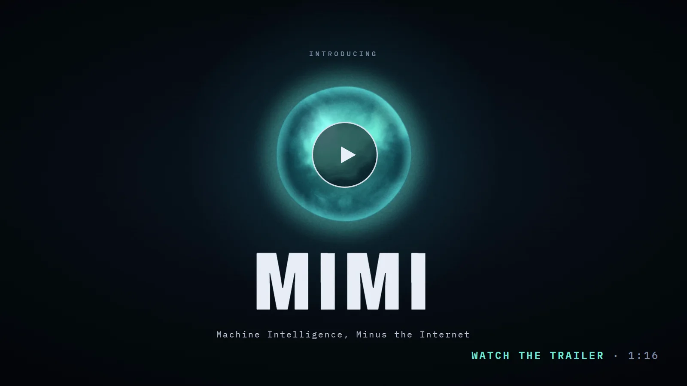
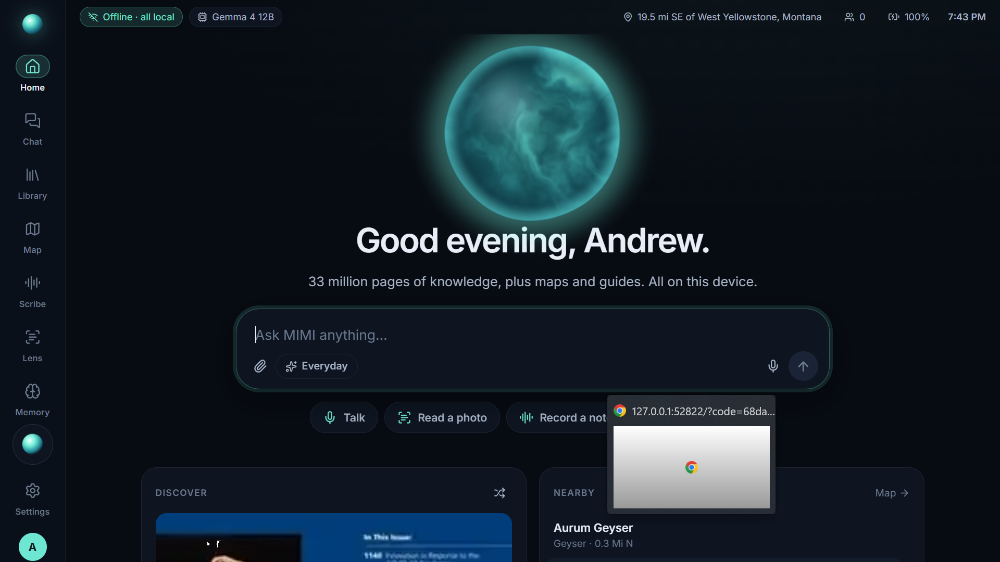
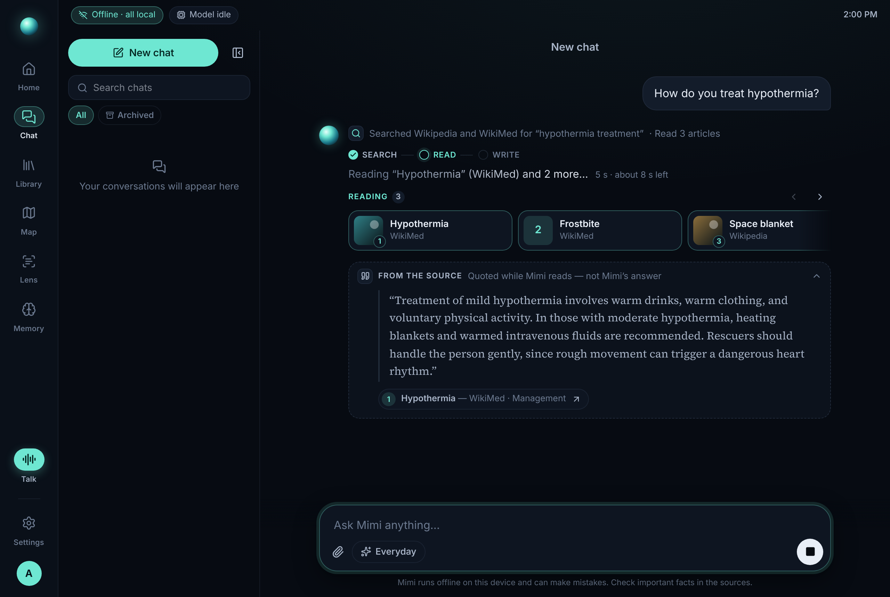
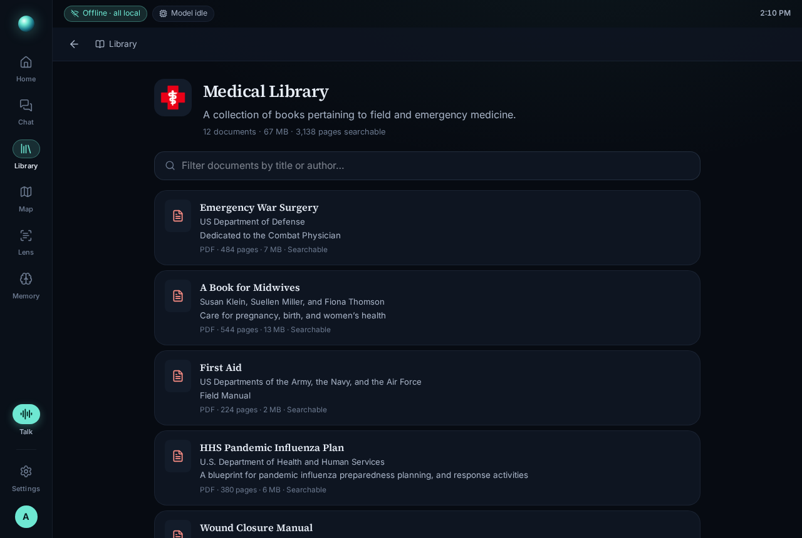
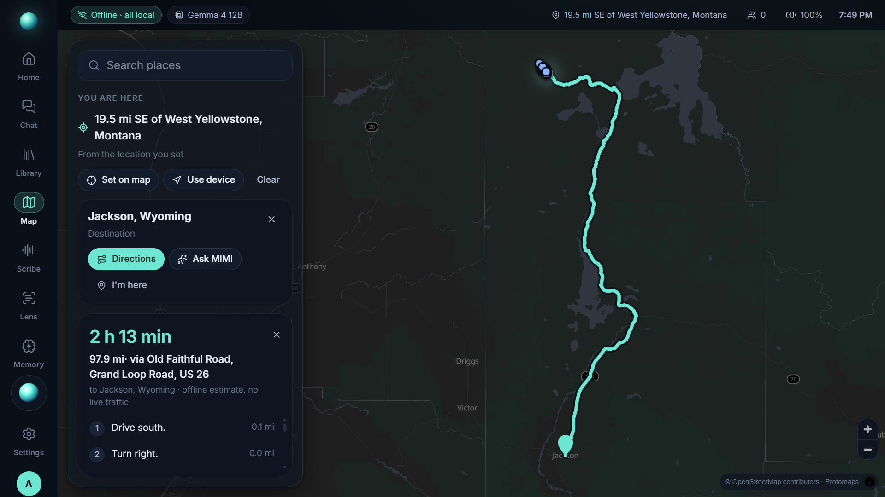

# Mimi — Machine Intelligence, Minus the Internet

[](https://github.com/AndrewKenady/mimi/actions/workflows/ci.yml)
[](LICENSE)
[](docs/DESIGN_SYSTEM.md#accessibility-commitments)

*An open-source, fully offline AI field station. The name nods to **Mímir**, the Norse keeper of wisdom whose counsel Odin carried.*

**[Watch the trailer](https://andrewkenady.github.io/mimi/#trailer)** (1:16) · **[Try the live demo](https://andrewkenady.github.io/mimi/demo/)**: the real interface in your browser, on recorded answers · **[Read the design case study](https://andrewkenady.github.io/mimi/case-study.html)**

[](https://andrewkenady.github.io/mimi/#trailer)

Mimi turns a small PC into an assistant that works with **zero internet**: a local open-weights model grounded in an offline library of medicine, repair, travel and survival guides, with maps, driving directions, voice and photo reading. The reference device is a handheld ONEXPLAYER F1 (Ryzen 7 7840U, 16 GB). It also runs on Linux, macOS and Docker.



## What makes it different

Small local models make things up, and in a field-medicine tool that matters more than speed. Mimi is built around being **checkably right**:

- **Answers come from the library, with sources.** Factual questions must go through a search first, and every claim cites the article or PDF page it came from (*"First Aid, p. 133"*). Sources and a verbatim quote from the best passage appear within seconds, before the model has written a word.
- **Every citation is checked.** After each answer, Mimi checks whether the cited passage actually supports the sentence: numbers, doses, names and negations included. A claim the source doesn't support gets a visible "check this" marker naming the reason, e.g. *number not in source: 45 °C*. The answer itself is never rewritten.
- **Answer quality is measured, not asserted.** A 166-question golden set (field medicine, repair, travel, survival, plus adversarial traps like dangerous dosing and false premises) scores retrieval, key facts, forbidden claims and citation faithfulness, and compares models head to head. Model and retrieval changes need an eval run ([docs/EVALUATION.md](docs/EVALUATION.md)), and published runs appear on the [scoreboard](https://andrewkenady.github.io/mimi/scoreboard.html).
- **The library is honest.** Every book is surveyed: can it be opened, can it be searched, how many items does it really have? PDF collections that other readers show as a blank page open as real document lists, and their text is indexed page by page so chat can cite them.

| Sources first, while Mimi reads | PDF collections, searchable by page | Offline directions |
|---|---|---|
|  |  |  |

### Everything else it does

- **Library:** all of English Wikipedia with images, WikiMed, iFixit, Wikivoyage, nine Stack Exchange sites, Wiktionary, survival and medical guides, Project Gutenberg shelves and TED talks. That's 26 collections in the standard tier.
- **Reads photos.** Lens does on-device OCR, and the vision model can explain, translate or identify what it sees.
- **Talks.** Full-screen voice conversation (Whisper and Kokoro, all on the device), or push-to-talk on the controller.
- **Takes notes.** Scribe records, transcribes, and writes the summary, key points and action items.
- **Knows where you are.** Offline maps, "what's near me", street-address search and **turn-by-turn driving directions** (Valhalla). Location comes from a USB GPS, a phone riding along, or the place you set.
- **Remembers you, transparently.** Suggested memories wait for your OK. Every one can be seen, edited, pinned, paused or erased.
- **Shares.** Phones and laptops on the same network, or on Mimi's own Wi-Fi, open `https://mimi.local` and sign in.
- **Extensible.** Slash commands (`/eli5`, `/translate spanish …`, `/steps`). Drop a Python file into `tools/` to give Mimi a new ability ([tools/README.md](tools/README.md)). It also works as an **MCP server**, so Claude Desktop and other MCP clients can use its offline library, places and directions ([docs/MCP.md](docs/MCP.md)).
- **Controller-first and accessible.** A native full-screen app with a living "Well" orb, gamepad navigation, a command palette, and dark, light and OLED themes. Every theme passes WCAG AA contrast, and every main screen passes an automated WCAG 2.2 audit, both checked in CI.

## Install

| | |
|---|---|
| **Linux, macOS** | `curl -fsSL https://raw.githubusercontent.com/AndrewKenady/mimi/main/scripts/install.sh \| sh` |
| **Windows 10/11** | `git clone https://github.com/AndrewKenady/mimi` then `powershell -ExecutionPolicy Bypass -File mimi\scripts\setup.ps1 -Tier lite` |
| **Docker** | `docker compose up -d`, then `docker compose run --rm mimi content add lite` |

Then open **http://localhost:7600** (on Windows, `MIMI.exe` opens it full screen). No administrator rights are needed.

| Tier | Download | Includes |
|---|---|---|
| **lite** (default) | ≈ 16–24 GB | Qwen3.5 4B, voice, WikiMed, iFixit, survival guides, Wikivoyage, the most-read Wikipedia articles, a world map plus your region in street detail |
| **standard** | ≈ 210–245 GB | Gemma 4 12B and Qwen3.5 9B, all of Wikipedia with pictures, Stack Exchange, TED, Gutenberg, driving directions and address search |
| **plus** | standard + 15 GB | Gemma 4 26B A4B, for 32 GB of RAM or a GPU with 16 GB+ |
| **max** | standard + 22 GB | Qwen3.6 35B A3B, for 48 GB+ of RAM or a GPU with 24 GB+ |

Mimi picks the Plus or Max models by itself on hardware that can run them, and uses the Standard ones until they're installed. Add or remove content any time with `python -m mimi content list | add | remove`. Every download comes from its original publisher, resumes if interrupted, and is checked against a pinned SHA-256 before it's used. [docs/INSTALL.md](docs/INSTALL.md) covers regions, Steam Deck, portable USB drives, and what has been tested on which platform.

## How it's built

| Piece | Tech |
|---|---|
| `core/` Mimi Core | Python 3.12, FastAPI, SQLite (FTS5), llama.cpp model manager (Vulkan, CUDA, CPU), kiwix-serve, faster-whisper, Kokoro-ONNX, RapidOCR, Valhalla, zeroconf |
| `ui/` Mimi app | SvelteKit (Svelte 5), Tailwind 4, MapLibre + PMTiles, WebGL "Well" |
| `shell/` MIMI.exe | WinForms + WebView2, compiled with the C# compiler that ships with Windows |
| `eval/` | Golden question set, runner and scorer for answer quality |

| Read | For |
|---|---|
| [ARCHITECTURE](docs/ARCHITECTURE.md) | How Core, the engines, the library, the chat streaming protocol and the security model fit together |
| [DECISIONS](docs/DECISIONS.md) | Each real choice, what it replaced and why, from the native shell to rank fusion and citation checks |
| [DESIGN_SYSTEM](docs/DESIGN_SYSTEM.md) | Principles, tokens, components, motion and accessibility commitments; the living style guide is at `/dev/design` in the app |
| [EVALUATION](docs/EVALUATION.md) · [BENCHMARKS](docs/BENCHMARKS.md) | How answer quality is measured; speed on the reference device |
| [THREAT_MODEL](docs/THREAT_MODEL.md) · [SECURITY](SECURITY.md) | LAN guests, a stolen drive, malicious library content or plugins: what's defended and what isn't |

### Quality bar

Every push runs [CI](.github/workflows/ci.yml) (Core on Linux, Windows and macOS):

- **Core:** 370 tests, from geocoding to the CA's name constraints and prompt-injection defenses, plus ruff.
- **UI:**
  - type checks;
  - a WCAG AA contrast audit of every theme × token pair;
  - 31 Playwright end-to-end tests against the real Core API, with a scripted model, covering the honest library, sources-first chat, flagged citations and recovery;
  - axe accessibility scans of every main screen in dark and light;
  - pixel snapshots of key screens.
- **Evaluation:** the scoring pipeline runs on fixtures and publishes its scoreboard.
- **Windows shell:** `MIMI.exe` is compiled.

Tagged releases ship SHA-256 sums and signed build-provenance attestations.

Development:

```bash
uv venv -p 3.12 && uv pip install -e "core[dev,build]"
cd core && python -m mimi serve        # Core + built UI on http://127.0.0.1:7600
cd ui && npm ci && npm run dev         # hot-reloading UI on :5173 (proxies to Core)
cd core && python -m pytest            # Core tests;  cd ui && npm run test:e2e for the browser suite
```

See [CONTRIBUTING.md](CONTRIBUTING.md). The most useful contribution needs no code: [report a wrong or badly sourced answer](https://github.com/AndrewKenady/mimi/issues/new?template=answer-quality.yml), and it becomes a test case.

## Licenses

Mimi's own code is [MIT](LICENSE). Models, engines and content keep their own licenses: Gemma 4 and Qwen3.5 (Apache-2.0), Wikipedia and Stack Exchange (CC BY-SA), OpenStreetMap (ODbL), GeoNames (CC BY), iFixit (CC BY-NC-SA), TED (CC BY-NC-ND) and others; see [docs/LICENSING.md](docs/LICENSING.md). Because some of that content is non-commercial, pre-loaded Mimi drives or images that include it may not be sold. The code itself has no such restriction.
